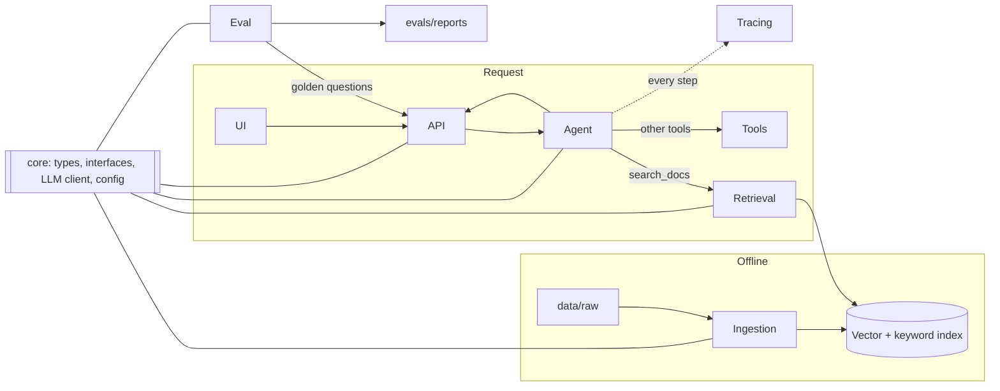

# Agentic RAG

A question-answering system that plans its own searches, checks what it found, and answers with citations to the source documents. When the evidence isn't there, it says so instead of guessing.

This README defines the six workstreams that build it, what each one owns, and the contracts between them. Each workstream can be owned by one person, several people, or the same person as the others. The boundaries stay the same either way.

---

## How it fits together



**The one rule:** workstreams only talk to each other through `src/agentic_rag/core/`. No folder imports another folder's internals. This is what lets the parts be built in parallel, against stubs, without merge fights.

---

## Quickstart

```bash
cp .env.example .env          # add your model API keys
make up                       # start the vector DB (and tracing UI)
make ingest                   # load data/raw into the index
make serve                    # start the API on :8000
make ui                       # start the chat UI
make eval                     # run the golden set, write a report
make test                     # unit tests
```

---

## Repository layout

```
agentic-rag/
├── Makefile
├── pyproject.toml
├── docker-compose.yml
├── .env.example
├── configs/
│   ├── default.yaml              # models, chunk size, top_k, budgets
│   └── prompts/                  # planner.md, answer.md, grader.md
├── data/
│   ├── raw/                      # source documents (gitignored)
│   ├── processed/                # chunks.jsonl
│   └── eval/golden.jsonl         # evaluation questions
├── src/agentic_rag/
│   ├── core/                     # Platform
│   ├── ingestion/                # Ingestion
│   ├── retrieval/                # Retrieval
│   ├── agent/                    # Agent
│   ├── api/                      # API, UI & Delivery
│   └── observability/            # Eval & Tracing
├── evals/                        # Eval & Tracing
├── ui/                           # API, UI & Delivery
├── tests/
└── docs/                         # architecture.md, runbook.md, demo.md, decisions/
```

---

## Workstreams

Each section answers the same questions: what it is responsible for, what it owns, what it consumes and produces, which decisions are its to make, and what "done" means.

### 1. Platform

**Responsible for** the foundation every other workstream stands on: the shared contracts, the single LLM client, configuration, local infrastructure and CI. Platform also keeps `main` runnable and runs the end-to-end check each evening.

**Owns**
- `src/agentic_rag/core/`: `types.py`, `interfaces.py`, `config.py`, `llm.py`, `cache.py`
- `docker-compose.yml`, `Makefile`, `pyproject.toml`, `.env.example`
- `configs/default.yaml`
- `.github/workflows/`

**Produces: the contracts**

```python
# core/types.py
@dataclass
class Document:
    id: str                 # content hash
    source: str             # path or URL
    title: str
    text: str
    metadata: dict          # page, section, date, doc_type, ...

@dataclass
class Chunk:
    id: str                 # stable: hash of doc_id + position + text
    doc_id: str
    text: str
    metadata: dict          # inherits Document.metadata + heading path

@dataclass
class RetrievalResult:
    chunk: Chunk
    score: float
    retriever: str          # "vector" | "keyword" | "hybrid" | "rerank"

@dataclass
class Citation:
    chunk_id: str
    doc_id: str
    quote: str              # the supporting span

@dataclass
class AgentStep:
    kind: str               # "plan" | "tool_call" | "observation" | "reflection" | "answer"
    content: dict
    tokens: int
    ms: int

@dataclass
class AgentAnswer:
    answer: str
    citations: list[Citation]
    steps: list[AgentStep]
    status: str             # "answered" | "insufficient_evidence" | "budget_exceeded"
```

```python
# core/interfaces.py
class Embedder(Protocol):
    def embed(self, texts: list[str]) -> list[list[float]]: ...

class Retriever(Protocol):
    def search(self, query: str, k: int, filters: dict | None = None) -> list[RetrievalResult]: ...

class Tool(Protocol):
    name: str
    description: str        # what the agent reads when choosing a tool
    input_schema: dict
    def run(self, **kwargs) -> dict: ...
```

**Decides:** vector database, model providers, Python version, dependency tooling.

**Done when:** contracts are merged on Day 1; `make up` and `make test` work on every machine; every LLM and embedding call in the codebase goes through `core/llm.py`; CI runs on every PR in under three minutes.

---

### 2. Ingestion

**Responsible for** turning raw documents into clean, well-labelled chunks in the index. Retrieval can only find what Ingestion put there, so most "the model got it wrong" bugs start here.

**Owns**
- `src/agentic_rag/ingestion/`: `loaders/`, `chunking.py`, `embed.py`, `pipeline.py`
- `data/raw/`, `data/processed/`

**Consumes:** files in `data/raw/`, the `Embedder` from core.
**Produces:** `Document` and `Chunk` objects, `data/processed/chunks.jsonl`, and a populated index.

**Pipeline**

```
load  →  clean  →  chunk  →  enrich metadata  →  embed  →  upsert
```

- **Load:** one loader per format, each returning `Document` with source, title, page and section metadata.
- **Chunk:** split on document structure (headings, sections) first, then by size. Start around 500–800 tokens with 10–15% overlap and keep the heading path in metadata. Tables stay whole.
- **Embed and upsert:** batched. IDs are content hashes, so re-running the pipeline is idempotent.

**Decides:** supported formats, chunking strategy, metadata schema.

**Done when:** every file in `data/raw/` loads without error; `make ingest` fills the index and a second run changes nothing; each chunk can be traced back to its document and page.

---

### 3. Retrieval

**Responsible for** finding the right chunks for a query, fast. Retrieval doesn't decide *when* to search or *what* to search for; that's the Agent. It answers one query as well as possible.

**Owns**
- `src/agentic_rag/retrieval/`: `vector_store.py`, `keyword.py`, `hybrid.py`, `rerank.py`, `query_rewrite.py`

**Consumes:** the index built by Ingestion, query strings and optional metadata filters.
**Produces:** ranked `list[RetrievalResult]` behind the `Retriever` protocol.

**Stages**

| Stage | What it fixes |
|---|---|
| Vector search | Finds passages that mean the same thing in different words |
| Keyword search (BM25) | Finds exact terms: names, IDs, codes, figures |
| Hybrid fusion (RRF) | Combines both rankings without tuning weights |
| Reranker (top 20 → top 5) | Puts the most relevant chunks first |
| Query rewriting | Turns vague or follow-up questions into standalone queries |

**Decides:** `top_k`, fusion method, reranker model, cut-offs. Every tuning choice is backed by eval numbers and recorded in `docs/decisions/`.

**Done when:** recall@5 on the golden set beats the plain vector-search baseline; added latency from reranking is measured and acceptable; final settings live in `configs/default.yaml`.

---

### 4. Agent

**Responsible for** the reasoning loop that makes this system agentic: deciding whether to plan, which tool to call, whether the evidence is good enough, and when to stop.

**Owns**
- `src/agentic_rag/agent/`: `graph.py`, `planner.py`, `reflection.py`, `memory.py`, `guardrails.py`, `tools/`
- `configs/prompts/`

**Consumes:** the `Retriever` (wrapped as the `search_docs` tool), any other `Tool`s, the LLM client.
**Produces:** `AgentAnswer` with citations and the full list of `AgentStep`s.

**The loop**

```
question
  └─ plan        simple question → go straight to search
                 multi-part question → split into sub-queries
  └─ act         call a tool (search_docs, calculator, ...)
  └─ observe     read the results
  └─ reflect     does this context answer the question?
                   no  → rewrite the query and search again (max 2 retries)
                   yes → continue
  └─ answer      every claim cites a retrieved chunk
                 or return status "insufficient_evidence"
```

**Guardrails**
- Hard limits per request on steps, wall-clock time and tokens.
- Text inside retrieved documents is data, never instructions to the agent.
- Citations that don't match a retrieved chunk are dropped before the answer is returned.

**Decides:** agent framework (recorded as an ADR on Day 1), tool set, prompts, retry policy.

**Done when:** multi-part questions score higher than on the Day 3 baseline; unanswerable questions get an honest refusal; no request exceeds its budget; follow-up questions work using conversation memory.

---

### 5. Eval & Tracing

**Responsible for** knowing whether the system is getting better. Eval measures it against a fixed set of questions; Tracing shows exactly what happened inside any single request. Together they turn "it feels worse" into a specific failing step.

**Owns**
- `data/eval/golden.jsonl`
- `evals/`: `run_eval.py`, `metrics.py`, `reports/`
- `src/agentic_rag/observability/tracing.py`

**Golden set format**

```json
{"id": "q017", "question": "...", "expected_answer": "...", "source_doc_ids": ["..."], "type": "multi_hop"}
```

Types: `lookup`, `multi_hop`, `comparison`, `follow_up`, `unanswerable`. Aim for 30–50 questions on Day 1, at least five of them unanswerable, written with someone who knows the domain.

**Metrics**

| Metric | Measures |
|---|---|
| Retrieval recall@k | Did the right chunks come back? |
| Answer correctness | Does the answer match the expected one? (LLM judge with a rubric) |
| Faithfulness | Is every claim supported by its citation? |
| Refusal accuracy | Does it decline unanswerable questions, and only those? |
| Latency and cost | Per question, p50 and p95 |

**Tracing** records, for every request: the plan, each tool call and its input, retrieved chunk IDs and scores, reflection decisions, token counts and timings.

**Decides:** what counts as "better", the regression threshold in CI, failure categories.

**Done when:** `make eval` writes a report to `evals/reports/`; a report is committed every evening from Day 3; any wrong answer can be traced step by step; CI fails a PR that drops correctness past the threshold.

---

### 6. API, UI & Delivery

**Responsible for** getting the system into people's hands: the HTTP API, the chat interface, the documentation, and the release and demo.

**Owns**
- `src/agentic_rag/api/`: `main.py`, `schemas.py`
- `ui/app.py`
- `docs/`: `architecture.md`, `runbook.md`, `demo.md`
- `Dockerfile`, release tags

**Consumes:** the Agent, returning `AgentAnswer`.
**Produces:** the endpoints below, the chat UI, docs and the release.

**API**

| Method | Path | Purpose |
|---|---|---|
| `GET` | `/health` | Liveness and index status |
| `POST` | `/ask` | Ask a question; streams agent steps, then the final answer (SSE) |
| `POST` | `/ingest` | Add or update a document (optional) |

```json
// POST /ask
{"question": "...", "conversation_id": "optional"}
```

**UI:** a question box, a streamed answer, citation chips that open the source passage, and a collapsible trace showing the agent's plan, searches and retries. The trace is what makes the agent visible in a demo.

**Delivery**
- Code freeze at 18:00 on Day 6; after that, only bug fixes merge.
- Tag `rc1` and run the demo from the container, not a laptop.
- `docs/demo.md` holds five showcase questions: a lookup, a multi-part question, a follow-up, an unanswerable one, and one that shows a retry.

**Decides:** UI framework, response format, demo script.

**Done when:** someone outside the team can run it from this README alone; the UI works without help; two full dry runs of the demo pass without surprises.

---

## Working agreements

1. **Contracts before code.** `core/types.py` and `core/interfaces.py` merge on Day 1. Changing them after that needs a heads-up to every workstream.
2. **Build against stubs.** Don't wait for another workstream; code against the interface with a fake until the real part lands.
3. **Main always runs.** Small PRs, merged the same day.
4. **Measure, then tune.** Every tuning change is justified by an eval report.
5. **Cut scope, not the demo.** If behind on Day 5, drop optional work first: the second tool, incremental ingest, the UI trace view.

## Milestones

| Day | Milestone |
|---|---|
| 1 | Contracts frozen, golden set v1, corpus collected |
| 2 | Every part built against stubs |
| 3 | Walking skeleton: question in, cited answer out, through the API |
| 4 | Agentic behaviour: planning, reflection, hybrid retrieval |
| 5 | Feature complete; failure analysis done |
| 6 | Code freeze at 18:00, `rc1` tagged |
| 7 | Demo |
